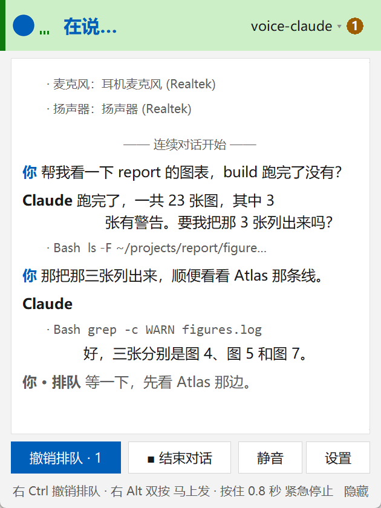

[中文](README.md) | **English**

# voice-claude

Talk to Claude Code on Windows instead of typing.

You can mix Mandarin and English in one sentence. Speech recognition (SenseVoice) and speech output (Kokoro) run on your own CPU, and besides Claude it can use DeepSeek, Kimi and GPT.



## Install

You need Windows 10 or 11, Python 3.11 or newer, and about 1.2 GB of disk space. Get Python from [python.org](https://www.python.org/downloads/windows/), or from [npmmirror](https://registry.npmmirror.com/binary.html?path=python/) in China, and check "Add python.exe to PATH" when you install it.

1. Download or clone this repository:

   ```
   git clone https://github.com/dazauzai/voice-claude
   ```

2. Double-click `install.bat`. Windows hides file extensions by default, so it may show up as "install" with the type "Windows Batch File".

`install.bat` creates `.venv`, installs the dependencies and downloads the speech models (about 640 MB). If Claude Code isn't installed, it also installs `claude-agent-sdk` (about 130 MB), which bundles its own copy of Claude Code; DeepSeek and Kimi run through it too. At the end it asks whether to install LiteLLM (about 550 MB). You only need it for an OpenAI API key, not for a ChatGPT plan. The default is no; to add it later, run `install.bat --with-gpt`.

It downloads from whichever source it can reach: PyPI or the Tsinghua mirror, GitHub or hf-mirror.com. `install.bat --mirror` forces the China mirrors. If it fails halfway, run it again; finished steps are skipped.

To install by hand instead:

```
python -m venv .venv
.venv\Scripts\pip install -r requirements.txt
.venv\Scripts\pip install claude-agent-sdk
.venv\Scripts\python scripts\download_models.py
```

Skip the third line if Claude Code is already installed.

## First start

Double-click `run.bat`. A console window flashes and closes; the app runs without one. The first start loads the models (about 3 seconds) and starts a background service. Then you'll hear "我是总机，要去哪个项目？" ("I'm the manager. Which project?").

The manager (总机) and each project have their own line. Say a project's name and the manager puts you through to that project's line.

If no model is connected yet, the **AI 服务商** (AI service) page opens by itself. This is where you choose who answers. You can set up several and switch between them by voice.

- **Claude**: click **登录…** (Sign in) to use your own Claude Code (Pro / Max), or enter an Anthropic API key.
- **DeepSeek**, **Kimi** (Moonshot): enter an API key. Each has a **获取 API key** (get an API key) link next to it.
- **GPT** (OpenAI): to use your ChatGPT plan, download the Windows build of the Codex CLI from its [releases page](https://github.com/openai/codex/releases) and put `codex.exe` in `%LOCALAPPDATA%\Programs\Codex\bin\` or any folder on your PATH (the npm `codex.cmd` wrapper is not supported), then click GPT's **登录…** button. Or enter an OpenAI API key (needs LiteLLM).

API keys are kept in `~/.voice-claude/auth.json`, which only your account can read.

## Usage

The main key is right Ctrl. The second key is right Alt.

| Action | Effect |
|---|---|
| Right Ctrl, one tap | Start recording; tap again to send. A tap while it's working or speaking interrupts it |
| Right Ctrl, two taps | Continuous conversation on / off: you talk, it answers out loud, then listens again, no keys needed |
| Right Ctrl, hold 0.8 s | Emergency stop for every line and tool (background jobs keep running) |
| Right Alt, one tap | Mute / unmute the microphone |
| Right Alt, two taps | Stop this turn and send what you said while it was talking |

In continuous conversation with headphones on, just start talking to make it stop speaking. Its work carries on and your words are queued. Pauses shorter than 2 seconds won't cut you off. Code blocks are shown in the window, not read out.

When you can't talk, type in the box at the bottom of the window and press Enter (Shift+Enter for a new line). It works the same as speaking.

To take something back, say "撤回上一句" (undo the last sentence; say it again to go further back), or right-click one of your sentences in the window and choose **从这里重来** (start over from here). The conversation goes back to just before it, and the sentence lands in the box for you to edit and send again. If the turns you undo changed files, it asks whether to change them back too.

A few things to say:

- "去 Atlas" or "接我到 Atlas 项目" (take me to the Atlas project). The manager first asks "要接到 Atlas 吗？" (connect you to Atlas?)
- "回到总机" (back to the manager), "后台怎么样了" (how are the background jobs doing), "撤回上一句" (undo the last sentence)
- "切到 DeepSeek" (switch to DeepSeek), "把模型切换成 sonnet" (switch the model to sonnet). Both ask you first
- "打开 AI 服务商" (open the AI service page), "打开通透模式" / "关闭通透模式" (transparent mode on / off), "结束对话" (end the conversation)

Say a fixed phrase on its own (a lead-in such as 好, 能不能 or 帮我 is fine); inside a longer sentence it goes to the model as ordinary words.

You can change settings by voice too, for example "把字号放大两个号" (font size up two steps) or "麦克风换成 USB 那个" (use the USB microphone). All settings live in `~/.voice-claude/config.toml`, created from `config.example.toml`, with every option commented.

To quit, use the window's ×, **退出 voice-claude** in settings, or **退出** in the line menu. Each one stops the background service and closes the window, asking first if a line is answering or a background job is running.

## Approvals and desktop control

It asks out loud before it does anything on your computer, and a yellow request card appears above the buttons. If it's going to type, it says which window the text goes into:

> 我想打开记事本，然后在记事本里输入文字 hello，可以吗？
> (I'd like to open Notepad and type "hello" in it. OK?)

Only a yes runs it. Say 可以 (yes) or 不行 (no), or press right Alt for yes and right Ctrl for no. A negation anywhere ("嗯，不行", "um, no") counts as no. If it can't make out your answer, it asks again, and no answer within 60 seconds is a no. This check is enforced in the tool code, not left to the model.

Each action can be set to ask, allow or deny (询问 / 允许 / 禁止) on the **权限** (permissions) page or by voice. The change itself is confirmed out loud. Move the mouse pointer to the top-left corner of the screen to stop mouse and keyboard actions at once.

**Transparent mode (通透模式).** If the questions get tiresome, turn it on by voice or on the **权限** page (you confirm once, then **通透** shows in the status bar). Anything set to ask then just runs, except deleting something or overwriting an existing file, which it still asks about, giving the reason first; deny stays deny. For clicks it only has the model's own name for the button, not the real one on screen. It only catches the common ways of deleting and overwriting, and only in voice-claude's own tools: Claude Code's own shell commands and file edits are checked by Claude Code's auto mode ([details](docs/guide.en.md)).

## Privacy

- Audio stays on your computer. Recordings are not stored or uploaded.
- The recognized text goes to the provider you chose.
- When the model looks at the screen, a screenshot of the whole screen goes to that provider. You're asked first, unless **看屏幕** (look at the screen) is set to allow or transparent mode is on.
- So the manager can recognize project names, its prompt includes a project index: each project's path from `~/.claude/projects`, when it was last used, its aliases and the first lines of its `MEMORY.md`.
- Logs contain what you said. They are local files you can delete: `voice-claude.log` and `desktop.log` in the program folder; `daemon.log`, `manager/log/` and `jobs/` in `~/.voice-claude/`. API keys never appear in logs.

## Known limits

- English terms inside Chinese sentences are sometimes misrecognized. You can add a replacement under `[replacements]` in the config.
- Kokoro's English pronunciation inside Chinese sentences is so-so.
- The hotkeys don't work while an app running as administrator has focus.

## Uninstall

Delete the program folder (it contains `.venv` and `models`) and `~/.voice-claude`. If you ever started the background service from a terminal inside another app, it left a scheduled task behind; remove it with `schtasks /delete /tn voice-claude-daemon /f`.

## Documentation

- [Manual](docs/guide.en.md) ([中文](docs/guide.md)): the window, every config option, the permission table, interrupting, tests
- Design notes: [architecture](docs/architecture.md), [the protocol between the window and the background service](docs/protocol.md) (in Chinese), [desktop control](docs/desktop-control.md) (in Chinese)
- [Third-party components and licenses](NOTICE.md) (in Chinese)
- [Contributing](CONTRIBUTING.md) (in Chinese, with a short English summary)

## License

MIT, see [LICENSE](LICENSE). The speech models are not in this repository. They are downloaded during install and each has its own license; see [NOTICE.md](NOTICE.md).

This is an independent project, not affiliated with or endorsed by Anthropic or OpenAI. Claude and Claude Code are trademarks of Anthropic; Codex and ChatGPT are trademarks of OpenAI. You install Codex yourself, and you sign in to Claude Code and Codex yourself. voice-claude never signs in for you and never touches your sign-in tokens.

This project was written with heavy use of Claude Code.
