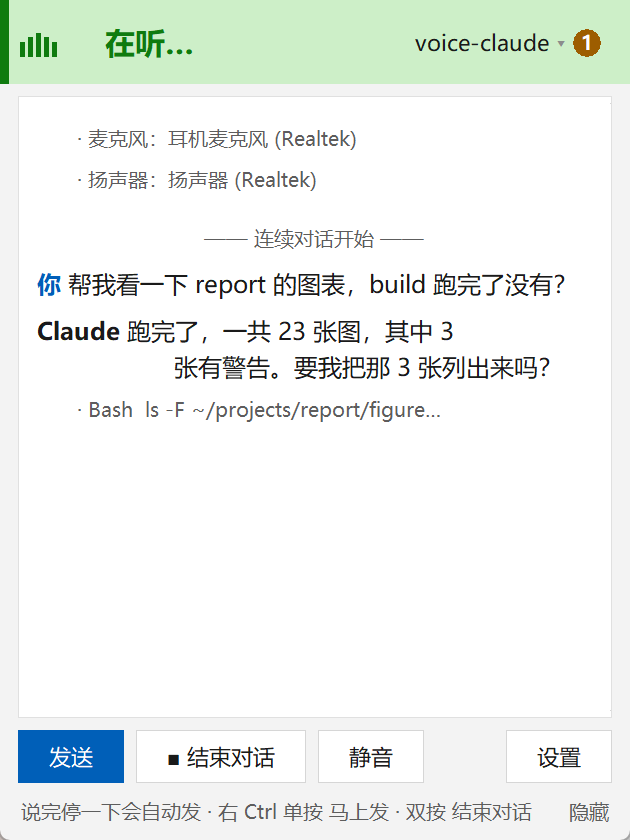
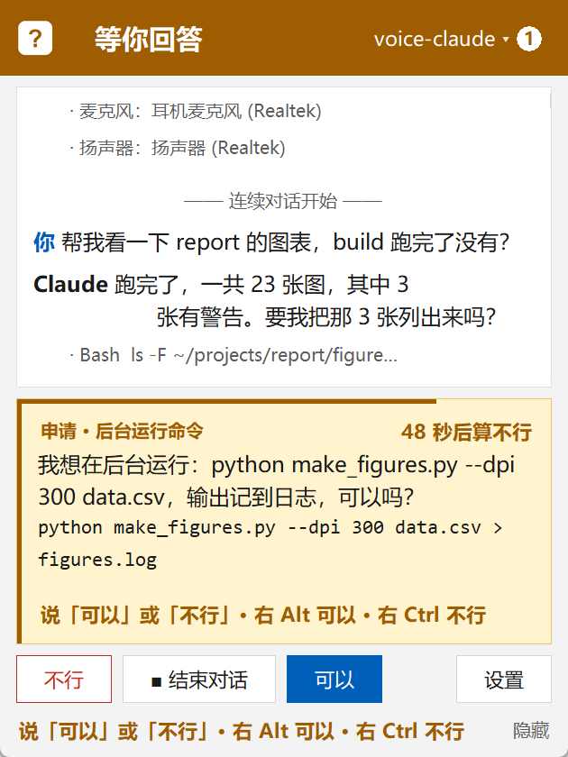
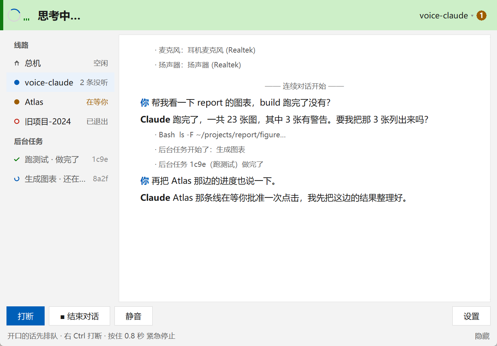

# voice-claude manual

The short version is the [README](../README.en.md).

Talk instead of type: work with Claude Code by voice, on Windows. Mandarin and English can be mixed in one sentence; speech recognition and text-to-speech run entirely on your own machine. DeepSeek, Kimi and GPT (API key or ChatGPT plan) work too.

中文说明见 [guide.md](guide.md)。

An independent open-source project, not affiliated with or endorsed by Anthropic or OpenAI. Claude and Claude Code are trademarks of Anthropic; Codex and ChatGPT are trademarks of OpenAI.

## What it does

- **Hands-free conversation.** Tap the right Ctrl key twice and just talk. It hears when you have finished, answers out loud while the reply is still being written, then listens again. Tap once to say one thing; tap once while it speaks to stop it; with headphones on, simply start talking to stop its voice (its work continues, your words are queued).
- **A receptionist ("the manager").** The program opens on a manager line. Say a project name ("take me to the Atlas project") and it asks "connect you to Atlas?", then hands you over to that project's own Claude Code conversation, with its own directory and memory. Say "back to the manager" to switch. Projects are found automatically from Claude Code's own records; aliases can be added by voice.
- **A separate background service.** Lines and long-running jobs live in their own process, so a window that crashes or is restarted reconnects to them. Quitting (the window's × or 退出 voice-claude) stops it.
- **Background jobs.** "Run this in the background" starts a detached command with its output in a log file; it reports back when it finishes.
- **Desktop control with a hard gate.** It can look at the screen, click, type, press keys, scroll and open programs, but **every action is first asked out loud** ("I want to open Notepad, OK?"). Only your "yes" (spoken, or right Alt) runs it. The gate is in the tool code, not in a prompt. Typing announces the window it will land in.
- **Transparent mode (通透模式)**, for when the questions get too many: everything set to "ask" just runs, except deleting something and overwriting an existing file, which are still asked. The check looks at the action itself (keys, typed text, commands, file changes); for a click it can only use the model's name for the target. It recognises the common delete and overwrite actions, not every one, and it covers voice-claude's own tools only: Claude Code's own shell and file edits are checked by its auto mode instead.
- **A permissions table** you can query and change by voice ("set screenshots to no-ask"; changing it is itself confirmed out loud).
- **Three levels of interruption.** Talking only silences the voice; a single tap of right Ctrl stops the current turn; holding right Ctrl for 0.8 s is the emergency brake for every line and tool.
- **Access.** Use your own logged-in Claude Code (subscription) or an Anthropic API key stored only on your machine. DeepSeek and Kimi (Moonshot) keys work through their Anthropic-compatible endpoints, with Claude Code as the engine. GPT works with your ChatGPT plan through the official Codex CLI (Codex is then the engine), or with an OpenAI API key through a local LiteLLM translation layer. Without any access the program still starts: a rules-only manager reports on background jobs and switches providers; connecting you to projects needs access.

## Install

Requirements: Windows 10/11, Python 3.11 or newer (tick "Add python.exe to PATH" when installing it), and about 1.2 GB of disk space (LiteLLM adds about 550 MB).

Then double-click `install.bat` (Windows hides extensions, so it may show as "install", type "Windows Batch File"). It creates `.venv`, installs the packages, installs the Claude Code engine when the official Claude Code is not there (`claude-agent-sdk`, about 130 MB, a bundled copy of Claude Code that also runs DeepSeek and Kimi), downloads the speech models (about 640 MB: SenseVoice, Silero VAD, Kokoro; licenses in [NOTICE.md](../NOTICE.md)), and asks whether to add LiteLLM (about 550 MB; needed only for an OpenAI API key, not for the ChatGPT plan; later: `install.bat --with-gpt`). It picks download sources that answer: PyPI or the Tsinghua mirror, GitHub or hf-mirror.com (`--mirror` forces the mirrors). Run it again after a failure; finished steps are skipped.

Then double-click `run.bat`. The first start opens the AI 服务商 (AI service) page. Pick one:

- **Claude**: sign in with your own Claude Code (Pro / Max, the 登录… button), or enter an Anthropic API key.
- **DeepSeek**, **Kimi (Moonshot)**: enter an API key.
- **GPT (OpenAI)**: install the Codex CLI: download the Windows build from the [official releases](https://github.com/openai/codex/releases) and put its `codex.exe` in `%LOCALAPPDATA%\Programs\Codex\bin\` or any folder on PATH (the npm `codex.cmd` wrapper is not supported); then press GPT's 登录… to use your ChatGPT plan. voice-claude never touches the tokens. Or enter an OpenAI API key (needs LiteLLM).

They coexist; say "切到 DeepSeek" to switch.

Manual install without `install.bat`:

```bash
python -m venv .venv
.venv\Scripts\pip install -r requirements.txt
.venv\Scripts\pip install claude-agent-sdk
.venv\Scripts\python scripts\download_models.py
```

## Run

Double-click `run.bat`, or:

```bash
.venv\Scripts\python -X utf8 -m voiceclaude
```

The first start loads the models (about 3 seconds) and starts the background service; you will hear "I am the manager, which project?". Each project's conversation continues where it left off. Your settings live in `~/.voice-claude/config.toml` (created from `config.example.toml` on first run); API keys in `~/.voice-claude/auth.json`.

Useful commands: `.venv\Scripts\python -m voiceclaude.daemon --status` shows whether the background service is running. Started from a terminal embedded in another app, the service is launched through the Windows Task Scheduler so it survives that app; this leaves a scheduled task named `voice-claude-daemon` (it only runs when called).

## The window

 

The window is meant to sit small and on top in a corner, read at a glance. Top to bottom:

- **Status bar**: a state orb and one line of large text. The colour of the whole bar answers a single question: **green = the microphone is open and it can hear you** (recording, listening, and during a conversation while it thinks or speaks, since you can talk over it); **dark amber = it is waiting for your decision**; grey = busy or idle; pink = broken. The orb's shape differs too: bars moving with your voice mean listening (with a frame: recording, tap again to send), a breathing blue disc means speaking, a spinner means thinking, a white square with a question mark means it is waiting for you. Mute is a badge on the orb, with " · 已静音" after the words; "通透" shows while transparent mode is on. The chip at the right names the current line; its badge counts unheard messages (amber when another line is waiting for you) and opens the lines-and-jobs panel.
- **Transcript card**: **你** (you), whoever answers (Claude, DeepSeek, GPT…) and **通知** (notice); tool calls ("· Bash …") and remarks step back as small grey lines. Scrolling up to read an old answer is not interrupted; a "↓ 回到最新" (back to latest) button appears instead.
- **Request card**: when it wants something approved, a yellow card docks above the buttons (visible even while you scroll or have the settings page open); the thin bar on top is the time left, the corner says "N 秒后算不行" (counts as no in N seconds). Answer by saying 可以 / 不行, or by key: right Alt (or the 可以 button) = yes, right Ctrl (or the 不行 button) = no. Once answered it moves into the transcript as a white card with your answer written on it ("你说：可以"). A background line's request is titled "后台的 Atlas 申请 · 点击" and the status bar says "Atlas 在等你".
- **Three buttons**: talk once / send / interrupt / drop the queue · N / no, start / end conversation, mute / unmute / yes; settings at the right. Buttons and keys do the same things.
- **Hint row**: one line of shortcuts that changes with the state; "隐藏" at its end hides it (`[ui] show_hints`, switchable again in settings).

 

Wider than 640 logical pixels, the window gains a permanent left column with the lines and background jobs, and the text column is capped at 38 Chinese characters and centred.

The settings page (设置 or Ctrl+,, [screenshot](ui/preview-settings.png), [lower half](ui/preview-settings-bottom.png)) lives in the same white card: entries to the AI 服务商 (AI service) and 权限 (permissions) sub-pages at the top, then microphone, speaker, font size, always on top, the hint row, the config file, and "退出 voice-claude" at the bottom.

- The permissions page ([screenshot](ui/preview-permissions.png)) starts with the transparent-mode switch; below it, each permission is 询问 / 允许 / 禁止 (ask / allow / deny). Choosing a new value sends the sentence to the line as if you had said it, so it is still confirmed out loud.
- The AI service page ([screenshot](ui/preview-access.png); also "打开 AI 服务商" by voice) picks who answers, holds each vendor's key, and signs in through Claude Code or Codex; it opens by itself when nothing can answer.
- Quitting: the window's ×, "退出 voice-claude" and the line menu's quit row ([screenshot](ui/preview-menu.png)) all stop the background service and close the window, asking first when a line is answering or a job is running.

Keys inside the window: Esc closes the panel or a page, End goes back to the latest entry, PageUp / PageDown scroll, Ctrl+= / Ctrl+− change the font size, Ctrl+, opens settings, Ctrl+L the line panel, Ctrl+T toggles always-on-top. Font sizes 8–40 work; every part grows with the font.

## Keys

| Action | Effect |
|---|---|
| Right Ctrl, one tap | Start recording; tap again to send. While it works or speaks: stop it (if your own words are still queued, the first tap only drops the queue). On a request: no |
| Right Ctrl, two taps | Start / stop continuous conversation |
| Right Ctrl, hold 0.8 s | Emergency stop: every line and tool |
| Right Alt, one tap | Mute / unmute the microphone. On a request: yes |
| Right Alt, two taps | Send the queued words now, interrupting the current turn |
| Just talk (headphones) | Lowers, then stops its voice; its work continues; your words are queued |

You can also type: the box at the bottom of the window, Enter to send, Shift+Enter for a new line. Typed text goes the same way as speech: it waits in the queue while a line is answering, fixed phrases work, and typing 可以 / 不行 answers a request card.

Rewind: say or type "撤回上一句" on its own (repeatable; a sentence like "把那个提交撤回" still goes to the model), or right-click one of your sentences in the transcript → 从这里重来. The conversation goes back to just before it and the sentence goes into the box; if the dropped turns changed files, it asks whether to change them back (Codex lines can rewind only the conversation).

Fixed phrases the program understands locally (in Chinese): "撤回上一句" undo the last sentence, "回到总机" back to the manager, "接杂项" scratch line, "进入后台模式" background mode, "后台怎么样了" how is the background doing, "关掉后台服务" shut down the background service, "撤销排队" drop the queued words, "打开 AI 服务商" open the AI service page, "打开通透模式" / "关闭通透模式" transparent mode on / off, "结束对话" end the conversation. Say them on their own (a lead-in such as 好, 能不能 or 帮我 is fine); inside a longer sentence they go to the model as ordinary words.

## Configuration

Everything is in `~/.voice-claude/config.toml`; see the comments in [config.example.toml](../config.example.toml). The main knobs: the hotkey, microphone and speaker (part of a device name), the pause that ends an utterance, barge-in on/off (off for loudspeakers), the Claude model and effort (the manager has its own, used on Claude), who answers (`[providers]`: Claude, DeepSeek, Kimi or GPT, with their model names; keys go in on the AI service page), the desktop allow-list of programs, the permissions table and transparent mode (`[permissions] transparent`), and word replacements for frequent mis-recognitions. The manager's prompt can be overridden with `~/.voice-claude/manager-prompt.md`.

## Tests

- Unit tests (no models, microphone, model service or keys; this is what CI runs): `.venv\Scripts\python -X utf8 -m unittest discover -s tests`
- Front-end harness with a fake background service: `.venv\Scripts\python -X utf8 scripts\frontend_harness.py`
- Full self-test with a real temporary background service and a real model (about 5 minutes, uses your quota; it starts real processes and may speak, so run it while nobody else is using the computer): `.venv\Scripts\python -X utf8 scripts\selftest.py`

See [CONTRIBUTING.md](../CONTRIBUTING.md) for the testing rules (never inject keystrokes, never touch the copy of voice-claude you are using).

## Privacy

- Audio is processed on your CPU and is never stored or uploaded.
- The recognised text goes to the provider you chose (through Claude Code or Codex), as when you use them in a terminal.
- Screenshots: when the model looks at the screen, an image of the whole screen (shrunk to 1280 px wide) goes to that provider. With 看屏幕 set to allow, or in transparent mode, that is no longer asked first.
- To understand "take me to …", the manager's prompt carries a project index: every project's path from `~/.claude/projects`, its last-active time, aliases and the first lines of its `MEMORY.md`. It goes to whichever provider the manager uses.
- Logs hold what you said, the answers and the text to be typed; they are local files you can delete at any time: `voice-claude.log` and `desktop.log` in the program folder; `daemon.log`, `manager/log/`, `jobs/`, `gateway.log` and `lines/*/codex-stderr.log` in `~/.voice-claude/`. Keys never appear in logs or in the window.

## Licenses

voice-claude is MIT licensed ([LICENSE](../LICENSE)). Speech models and other third-party components are not in the repository and have their own licenses and terms; see [NOTICE.md](../NOTICE.md). Claude Code is Anthropic's software and Codex is OpenAI's, both installed and logged in by you; voice-claude never logs in on your behalf and never touches the tokens.

This project was written with heavy use of Claude Code.

## Uninstall

Delete the program folder (it holds `.venv` and `models`) and `~/.voice-claude`. If the background service was ever started through the Task Scheduler, also run `schtasks /delete /tn voice-claude-daemon /f`.

## Documentation

`architecture.md` (how the pieces fit), `protocol.md` (the protocol between the window and the background service), `desktop-control.md` (desktop control and its gate).
